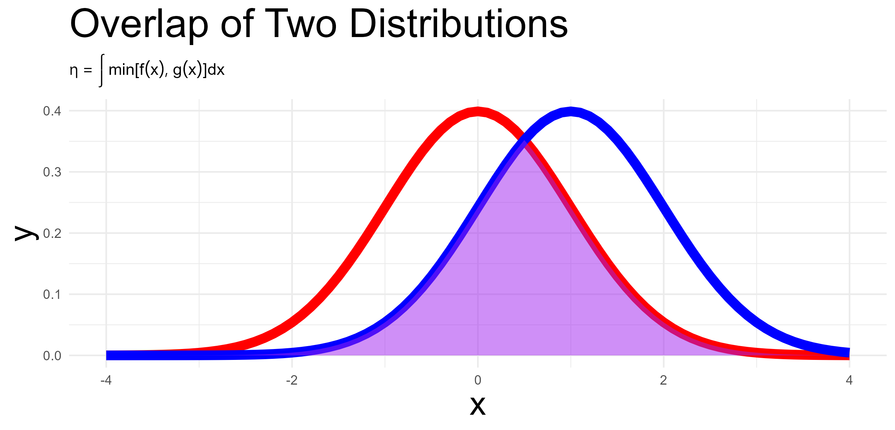

# Same Same Different Different:  Quantifying Similarity and Difference in Parenting and Child Development

Consider the following multilevel model:

$$\text{child behavior outcome} = \beta_0 + \beta \text{parenting} + \Sigma \beta \text{covariates} + u_{0j} + u_{1j} \times \text{parenting} + e_{ij}$$

In the equation above, all of the error terms have the usual interpretations, but notably $u_{1j}$ quantifies the country specific differences in the degree to which parenting is associated with the child behavior outcome. 

Thus $\textcolor{red}{u_{1 \text{country 1}}}$

There are a number of both Bayesian and frequentist methods to obtain estimates of the distribution of these country specific random effects. 

$$\textcolor{purple}{\eta_{overlap}} = \int min[\textcolor{red}{f(x_1)}, \textcolor{blue}{g(x_2)}] dx$$

