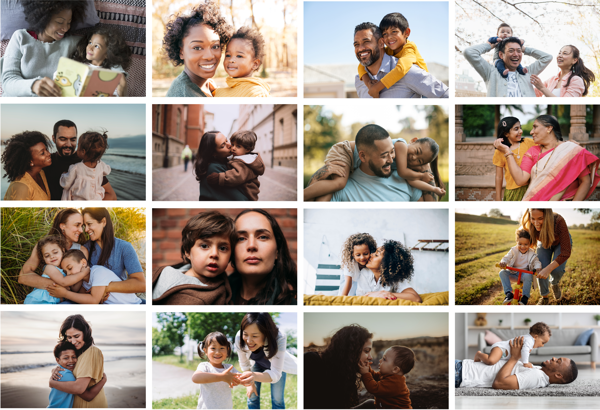
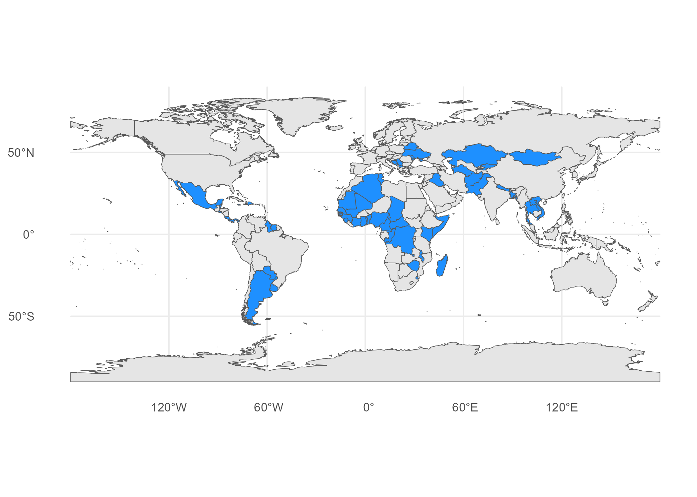
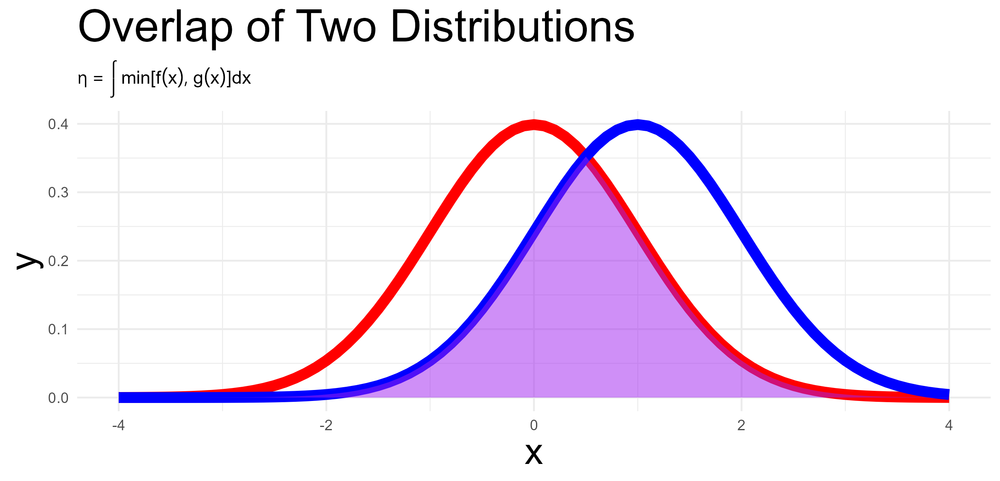
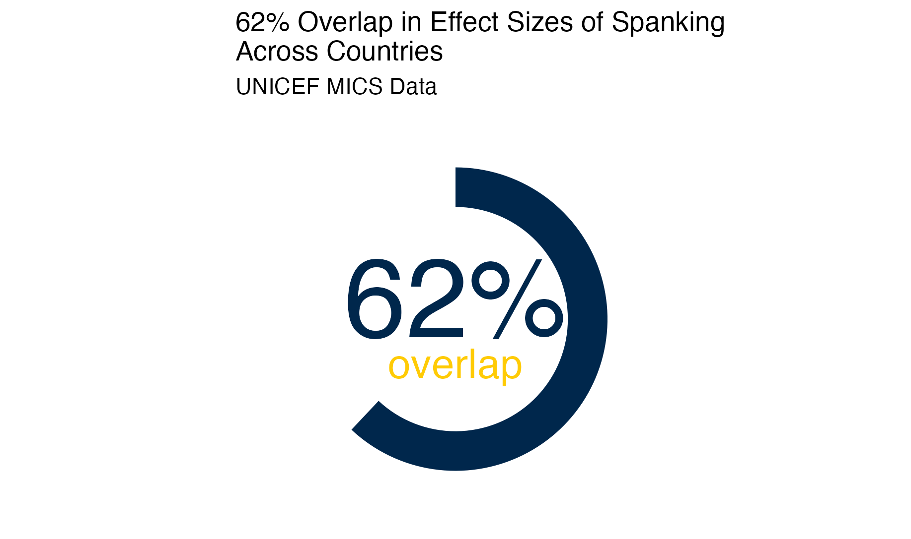

# Are We Similar? Are We Different?

::: {layout-ncol=2}

:::

MICS data collected by UNICEF from Low and Middle Income Countries (LMIC) around the world. 

$N = 224,632 \text{ families}; N_{countries} = 60$

Contains questions about parental discipline (both positive and negative) and child aggression. 

# Highlighting Commonalities May Promote Intergroup Attitudes And Solidarity

> "@Hanel2019 cite research suggesting that ['highlighting similarities between groups improves interpersonal and intergroup attitudes.']{color="#FF0000"} Others have argued that ['build[ing] bonds of commonality across our differences' might be an impetus for social transformation]{color="#FF0000"} [@Hunt-Hendrix2024]."

# The Argument 

* Families, parents and children experience an incredible [diversity]{color="#FF0000"} of circumstances.
* Parents engage in parenting behaviors with consequent [diversity]{color="#FF0000"}, though with some [surprising similarities]{color="#FF0000"}.
* The associations of parenting with child outcomes are [surprisingly consistent]{color="#FF0000"}.

# Equations and Calculations

Consider the following multilevel model:

$$\begin{aligned}
& \text{child behavior outcome} = \beta_0 + \beta \text{parenting} + \Sigma \beta \text{covariates} + \\ 
& u_{0j} + u_{1j} \times \text{parenting} + e_{ij}
\end{aligned}$$ {#eq-MLM}

In the equation above, all of the error terms have the usual interpretations, but notably, $u_{1j}$ quantifies the country specific differences in the degree to which parenting is associated with the child behavior outcome. 

Thus $\textcolor{red}{u_{1 \text{country 1}}}$ would provide information about the country specific association in country 1, while $\textcolor{blue}{u_{1 \text{country 2}}}$ would provide information about the country specific association in country 2.

There are a number of both Bayesian and frequentist methods to obtain estimates of the distribution of these country specific random effects. 

After obtaining estimates of these country specific effects, one could estimate the amount of overlap, or similarity, in these country specific random effects using the R library `overlapping` [@Pastore2018; @Pastore2019], which employs the formula below [@Pastore2018; @Pastore2019]:

$$\textcolor{purple}{\eta_{\text{overlap}}} = \int min[\textcolor{red}{f(x_1)}, \textcolor{blue}{g(x_2)}] dx$$ {#eq-overlap}

{width=50%}

@eq-overlap would provide an estimate of the similarity and difference in country specific relationships of parenting and child behavior outcomes. 

# Preliminary Findings

{width=50%}

# Why Is This Important?

> "The current times are seeing changes at an arguably unprecedented rate, and often much for the worse--with @Ahenakew2025 describing this confluence of challenges as a '[polycrisis]{color="#FF0000"}'--including a failing response to climate change, capitulation to autocrats and divisive leaders, failures to adequately care for the poor and infirm, fear of immigrants and the Other, and many more. [Responding to all of these issues requires some vision of common humanity to unite and motivate us, while also requiring an approach sensitive to local conditions and needs...]{color="#FF0000"}" [@Lomas2026]

